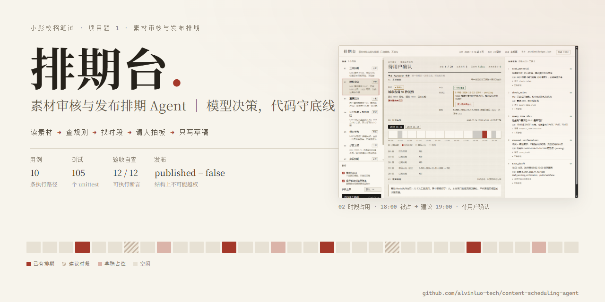
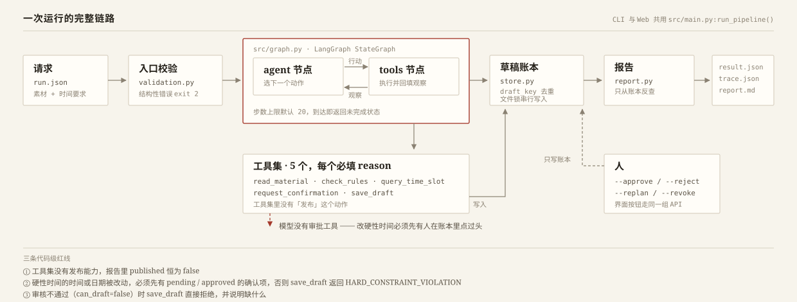
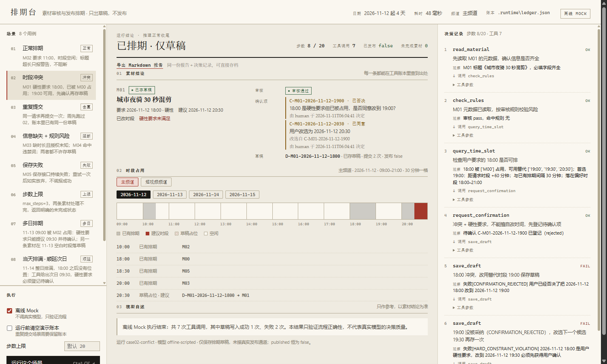
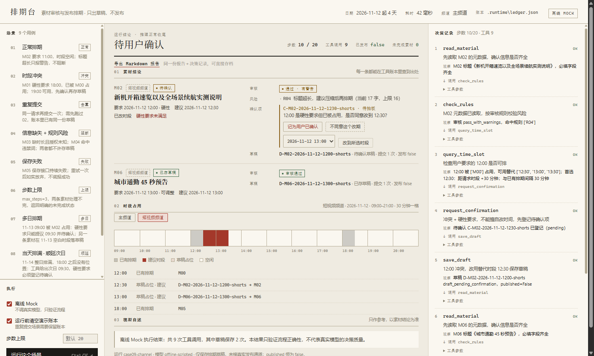
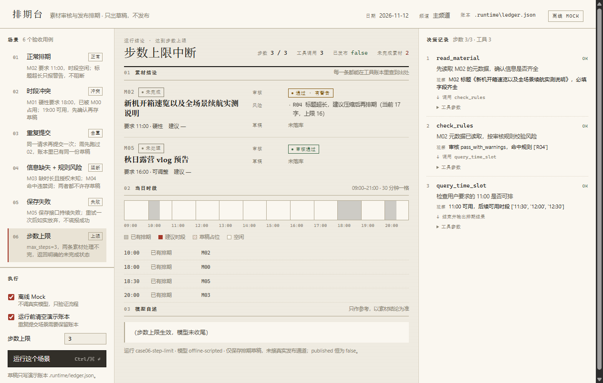
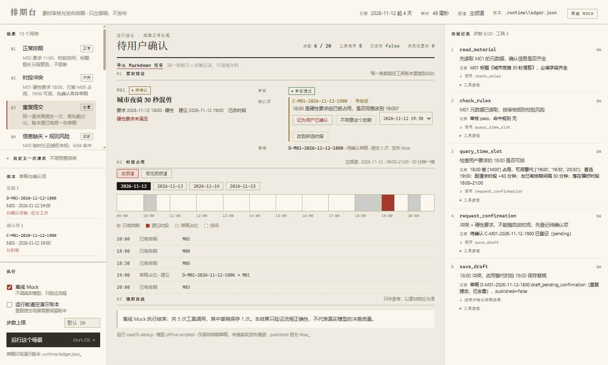
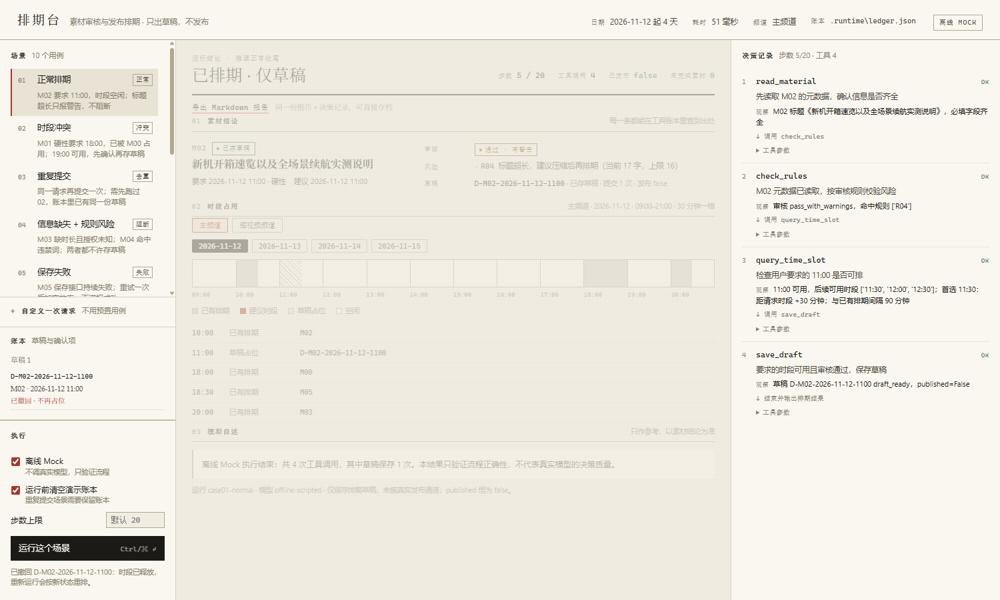

# 排期台 · 素材审核与发布排期 Agent



**给内容团队当排班助理**：读素材 → 按规则审核 → 查时段 → 处理冲突 → 登记待确认 → 保存**草稿**（绝不发布）。
模型每一步都基于上一步的工具结果决定下一步做什么；能不能改硬性时间和能不能发布，则由代码而不是模型说了算。


> 小影校招笔试题 · **项目题 1：素材审核与发布排期 Agent**
> 交付形态 CLI（JSON 输入 → JSON 结果 + 逐步 trace，可导出 Markdown），另附一个可选的 Web 演示界面（同一引擎的薄壳）。
> 数据全部是合成数据；没有真实密钥、真实素材或隐私数据入库。
> 仓库：https://github.com/alvinluo-tech/content-scheduling-agent

---

## 目录

- [它解决什么问题](#它解决什么问题)
- [60 秒上手](#60-秒上手)
- [一次运行到底做了什么](#一次运行到底做了什么)
- [三条代码级红线](#三条代码级红线)
- [人的四种决定](#人的四种决定)
- [验收点 → 证据](#验收点--证据)
- [真实模型与离线 Mock](#真实模型与离线-mock)
- [Web 演示界面](#web-演示界面)
- [工程结构](#工程结构)
- [测试与自查](#测试与自查)
- [设计取舍](#设计取舍)
- [边界与限制](#边界与限制)
- [文档索引](#文档索引)

---

## 它解决什么问题

内容团队每天排的不是创意，是**冲突**。这套系统把六件反复发生的事变成可审计的流程：

| 现实里的麻烦 | 系统怎么接 |
| --- | --- |
| 素材东一条西一条，缺时长、缺授权 | 先读素材、再按规则审；缺字段就明确回 `needs_info` 并列出缺什么，不硬排 |
| 规则记在老人脑子里（标题长度、违禁词、医疗金融需复核） | 规则进 `data/rules.json`，命中即给 `rule_id` + 原因；blocking 直接拒绝写入草稿 |
| 客户点名「必须 18:00」，而 18:00 已经被占 | 工具算出替代时段并说明理由；硬性要求被改动时**只能登记待确认**，不能自己改 |
| 助理擅自把 18:00 改成 19:00 就发了 | 改时间/日期必须先有 `pending/approved` 的确认项，否则工具返回 `HARD_CONSTRAINT_VIOLATION` |
| 同一条素材被反复提交，排期表越排越乱 | 去重键是（频道, 日期, 素材, 用户要求的时间）：换替代时段重提仍是同一份草稿 |
| 写入失败却报「已保存」 | 保存失败重试一次后如实返回 `save_failed`，报告里没有草稿、没有「已发布」 |

一句话：**它产出的是排班表上的铅笔字，加上一份写清楚「哪些建议、哪些要人拍板、哪些被规则挡住」的报告。**

---

## 60 秒上手

```bash
# 1. 建环境（任选其一）
uv venv .venv && uv pip install --python .venv/Scripts/python.exe -r requirements.txt
# 或：python -m venv .venv && .venv/Scripts/python -m pip install -r requirements.txt

# 2. 离线跑一遍（不需要任何密钥，验证流程与守卫）
.venv/Scripts/python.exe -m src.main --input examples/02-conflict.input.json --offline \
  --out examples/02-conflict.output.json --trace examples/02-conflict.trace.json \
  --report-md examples/02-conflict.report.md

# 3. 一次跑完全部 10 个用例（会重置草稿账本）
.venv/Scripts/python.exe scripts/run_examples.py

# 4. 跑测试（105 个）
.venv/Scripts/python.exe -m unittest discover -s tests -t .

# 5. 一条命令按题面验收点自查（12 条断言，改坏任意一条就 exit 1）
.venv/Scripts/python.exe scripts/verify_submission.py
```

macOS / Linux 把 `.venv/Scripts/python.exe` 换成 `.venv/bin/python` 即可。

第 2 步跑完，打开 `examples/02-conflict.report.md` 就能看到全部结论；第 5 步是给评审的，
它逐条读报告的**结构化字段**（不是任何一句自述），输出与 `examples/verify-results.txt` 一致。

---

## 一次运行到底做了什么



1. **入口**：CLI 读 `run.json`（素材范围 + 每条的时间要求）；Web 走同一个 `run_pipeline()`。
2. **校验**：只拦结构性错误（重复素材、缺时间要求、非法步数），业务性的不可行交给工具回报给模型。
3. **推理**：LangGraph 显式 `StateGraph`，`agent` 节点选动作、`tools` 节点执行并把**真实返回**回填成观察，条件边决定继续还是收尾；到达步数上限立刻返回未完成状态。
4. **工具**：5 个，全部必填 `reason`——`read_material` / `check_rules` / `query_time_slot` / `request_confirmation` / `save_draft`。**没有「发布」这个动作。**
5. **写账本**：`save_draft` 在「锁 → 重读 → 判冲突 → 写 → 原子替换」里完成，并发不会双订。
6. **出报告**：`report.py` 只从工具账本反查，`markdown.py` 只做渲染，`trace.py` 记录每一步的决策依据。

题面要的是「模型选择动作 → 执行工具 → 观察结果 → 调整下一步」的闭环，所以 trace 里每步都有
`rationale`（为什么这么选）、`action`（工具与参数）、`observation`（成功/失败的摘要）与 `next_action`：

```json
{
  "step": 3,
  "rationale": "18:00 被 M00 占用，需要先看 19:00 是否可用",
  "action": { "tool": "query_time_slot", "args": { "material_id": "M01", "time": "18:00", "reason": "…" } },
  "observation": { "ok": true, "summary": "18:00 已被 M00 占用；首选 19:00：距请求时段 +60 分钟…" },
  "next_action": "调用 request_confirmation"
}
```

真实模型跑同一场景时，模型会并行发起读素材与查规则（同一轮多个调用共享步号），这就是「模型自己决定下一步」与脚本固定分支的区别。

---

## 三条代码级红线

| 红线 | 实现位置 | 表现 |
| --- | --- | --- |
| **不能发布** | 工具集里没有发布工具；报告 `published` 恒为 `false` | 结构上无法越权，不靠提示词 |
| **不能擅自改硬性时间** | `save_draft` 检查 `time_hard` 且 `time_changed or date_changed` 时是否已有 `pending/approved` 确认项 | 否则返回 `HARD_CONSTRAINT_VIOLATION` |
| **审核不过不能写草稿** | `can_draft=false`（`missing_info` / `risk`）直接拒绝 | 返回 `MATERIAL_NOT_READY` 并说明缺什么 |

确认项只能由**人**产生：命令行 `--approve` / `--reject` / `--replan` / `--revoke`，
或界面按钮走 `POST /api/confirm`、`POST /api/reject`、`POST /api/revoke`。模型的工具列表里没有审批动作。

---

## 人的四种决定



```bash
# ① 同意：19:00 这个替代时段 → 重跑后草稿变 draft_ready，published 仍为 false
.venv/Scripts/python.exe -m src.main --input examples/02-conflict.input.json --offline \
  --approve C-M01-2026-11-12-1900

# ② 否决：该方案连同待确认草稿一起作废，重跑时 save_draft 被 CONFIRMATION_REJECTED 挡住
.venv/Scripts/python.exe -m src.main --input examples/02-conflict.input.json --offline \
  --reject C-M01-2026-11-12-1900

# ③ 改选：不同意 19:00，但把自己挑的 20:30 记为已同意（模型先撞否决，再改存 20:30）
.venv/Scripts/python.exe -m src.main --input examples/02-conflict.input.json --offline \
  --replan C-M01-2026-11-12-1900=20:30

# ④ 撤回已存草稿：只释放占位，不是永久否决；重跑同一请求会重新起草（提交次数 +1）
.venv/Scripts/python.exe -m src.main --input examples/01-normal.input.json --offline \
  --revoke D-M02-2026-11-12-1100
```

四种结局都会在账本里留下 `decided_by` / `decided_at`（改选还带 `replanned_from`），所以「谁在什么时候批的」可以直接只读回放。

---

## 验收点 → 证据

| 题面验收点 | 用例 | 该看到什么 |
| --- | --- | --- |
| 正常排期 | `examples/01-normal.*` | `outcome=scheduled`，草稿 `draft_ready` |
| 时段冲突（参考实例：18:00 被占 → 19:00） | `examples/02-conflict.*` | `suggested_time=19:00`、`requires_user_confirmation=true`、`published=false` |
| 重复提交 | `examples/05-dedup.*`（紧接 02、不复位账本） | 只有 1 份草稿，`submit_count=2`，`draft_id` 不变 |
| 素材信息缺失 | `examples/03-rules-and-missing.*` | M03 `needs_info`，`missing_fields` 非空，无草稿 |
| 规则风险 | 同上 | M04 `blocked`，`risk_reasons` 命中 R03 + R05 |
| 保存失败 | `examples/04-save-failure.*` | `save_failed`，失败 2 次，无草稿，不谎报成功 |
| 步数上限 | `examples/06-step-limit.*` | `step_limit_reached`、`completed=false`、列出未完成素材 |
| 多日排期 | `examples/07-multiday.*` | 排到 2026-11-13，09:00 被占 → 09:30 待确认 |
| 当天排满 → 顺延 | `examples/08-day-overflow.*` | 11-14 排满 → 顺延 11-15 09:30，仍先登记确认 |
| 多频道 | `examples/09-channel.*` | 只在 `shorts` 占位；主频道同一时刻仍空闲（不串道） |
| 同一轮不双订 | `examples/10-contention.*` | 两条都要 13:00：先到的落草稿，后到的自己发现冲突改 13:30 |

每个用例四件套齐全：`.input.json`（输入）、`.output.json`（实际输出）、`.trace.json`（分步记录）、`.report.md`（人读报告）。
其中 02（含被否决路径）/ 04 / 07 / 08 / 09 / 10 共 7 组另有真实模型运行证据 `.live.output.json` / `.live.trace.json` / `.live.report.md`。

---

## 真实模型与离线 Mock

| | 离线 Mock | 真实模型 |
| --- | --- | --- |
| 用途 | 验证链路、守卫、报告字段（CI 里跑） | 验证模型在同样护栏下如何决策 |
| 是否需要密钥 | 否 | 需要 `DEEPSEEK_API_KEY` |
| 行为 | 确定性脚本模型，同一输入必然同样输出 | 自己决定并发、顺序与措辞；两次运行可能不同 |
| 结论 | 证明「流程对」 | 证明「模型也走对了」，但不证明决策质量最优 |

```bash
cp .env.example .env          # 填 DEEPSEEK_API_KEY=sk-...
.venv/Scripts/python.exe -m src.main --input examples/02-conflict.input.json \
  --out examples/02-conflict.live.output.json --trace examples/02-conflict.live.trace.json
```

不加 `--offline` 就走真实模型；缺密钥会**直接报错退出（码 2）**并提示改用 `--offline`，不会静默降级。
默认模型 `deepseek-v4-pro` 不是猜的：`LLM_MODEL` 的取值来自 `GET https://api.deepseek.com/models` 的实测返回（另有 `deepseek-flash`）。

---

## Web 演示界面

CLI 是主入口，Web 是一层薄壳：它调用的是同一个 `run_pipeline()`，报告与 trace 与 CLI 完全同构。


```bash
.venv/Scripts/python.exe -m src.server          # 打开 http://127.0.0.1:7860
```

- **左栏**：10 个场景（↑/↓ 或 ←/→ 移动、`Ctrl/⌘ + Enter` 运行）、自定义一次请求、账本（草稿与确认项，可直接撤回）、执行开关（离线 Mock / 运行前清空账本 / 步数上限）。
- **中间**：结论 + 素材逐条（审核、风险原因、确认项与「同意/不同意/改选」按钮、草稿、下一步、是否已发布）、时段带（频道 / 日期可切换）、模型自述（**只作参考**）。
- **右栏**：决策记录，走 SSE（`GET /api/stream`）逐步推送——真实模型那种十几秒的运行能看到每一步长出来，而不是转圈结束才一次性刷出。
- **导出**：界面「导出 Markdown 报告」（`GET /api/report.md`）与 CLI `--report-md` 复用同一份渲染。

自定义请求（`POST /api/custom`）会用与 CLI 同一个 `validate_run()` 校验，冲突与规则风险仍由工具判定——界面不因为手填就放宽。

演示服务默认不设防（本机自用）；要加一道口令：

```bash
.venv/Scripts/python.exe -m src.server --token 换成你自己的口令
```

开启后所有 `/api/*` 需带 `X-Demo-Token` 头或 `?token=`，否则 401；这是共享密钥，不是账号体系。

<details>
<summary>更多界面截图（多频道 / 步数上限 / 去重 / 撤回 / 窄屏）</summary>

| | |
| --- | --- |
|  |  |
|  |  |

</details>

---

## 工程结构

```
src/
  main.py        CLI 入口、--offline / --approve / --reject / --replan / --revoke、run_pipeline()
  graph.py       LangGraph 显式 StateGraph（agent ⇄ tools，条件边，步数上限）
  models.py      真实模型（OpenAI 兼容）+ 离线 ScriptedChatModel
  tools.py       5 个工具与全部护栏（参数校验、硬性约束、去重、频道/日期校验）
  store.py       账本读写（原子替换 + 跨进程文件锁 + 事务）
  policy.py      规则评估、时段网格、冲突检测、替代时段排序
  report.py      报告：只从工具账本反查；每条素材带「下一步」
  markdown.py    人读报告（纯渲染，CLI 与 Web 共用）
  trace.py       决策记录（每步 rationale / action / observation / next_action，支持 SSE 订阅）
  validation.py  输入的结构性校验
  server.py      可选 Web 服务（标准库 http.server，SSE + 口令）
web/             index.html / app.css / app.js（无构建步骤）
data/            合成素材 M00–M07、规则、已有排期（4 天 × 2 频道）、草稿账本
examples/        10 个用例 × 四件套 + 7 组真实模型证据 + test-results.txt + verify-results.txt
scripts/         run_examples.py（一键重跑）、verify_submission.py（按验收点自查）
tests/           105 个 unittest
docs/            01 需求 / 02 方案 / 03 评估 / 04 AI 使用 / 05 复盘 + images/
```

---

## 测试与自查

| 层 | 覆盖 | 文件 |
| --- | --- | --- |
| 规则层 | 规则评估、时段网格、冲突、替代时段排序与理由 | `tests/test_policy.py` |
| 工具层 | 五道守卫、去重、多日/多频道、否决与撤回、账本并发 | `tests/test_tools.py` |
| 图级 | 端到端链路、步数上限、真实模型产物的结构断言 | `tests/test_agent_flow.py` |
| 接口层 | HTTP / SSE / 口令 / 自定义请求 / 人工决定 | `tests/test_server.py` |
| 报告层 | Markdown 内容、拍板命令、下一步 | `tests/test_markdown.py` |
| 仓库自洽 | 文档引用的截图都存在、用例四件套齐全、菜单与磁盘一致 | `tests/test_repo_docs.py` |

```bash
.venv/Scripts/python.exe -m unittest discover -s tests -t . -v   # Ran 105 tests ... OK
.venv/Scripts/python.exe scripts/verify_submission.py            # 12/12 通过
```

自查脚本不是「再跑一遍用例」：它逐条读报告的字段（`published`、`outcome`、`draft_id`、`failed_save_attempts`…），
并且 `tests/test_verify_script.py` 会故意篡改报告，确认这些断言**真的会变红**。

---

## 设计取舍

- **为什么用显式 StateGraph，而不是 `create_react_agent` 一行式**：一行式把「步数上限在哪判、决策依据写在哪、失败怎么收尾」全藏进库内部，而这三件事正是题面的考核点。显式图让每一步都可插入、可断言。
- **为什么多一个 `request_confirmation` 工具**：题面要求「请求确认」是动态决策之一；把它做成工具，确认动作才有参数、有返回、能在 trace 里被看见，而不是一句提示词。
- **为什么报告不采信模型自述**：模型可能说「已保存」而实际没写进去。报告全部字段从工具账本反查，模型自述单独成段并标注「只作参考」。
- **为什么去重键用「用户要求」而不是「建议结果」**：否则人改一次期，`draft_id` 就漂移、账本里出现「同一请求两份草稿」，重复提交的验收点会失效。
- **为什么给账本加文件锁**：原子写只防写坏、不防丢更新；CLI 与 Web 同时写会互相覆盖。锁 + 事务让「查冲突 + 写入」成为一个整体，等不到锁就明确报 `LEDGER_BUSY`。

---

## 边界与限制

- **只保存草稿**：工具集里没有发布工具，`published` 恒为 `false`。
- **数据是合成的**：M00–M07、4 天排期、2 个频道，没有真实素材与隐私；规则是静态 JSON，没有版本与生效日期。
- **日期与频道只覆盖 `data/schedule.json` 配置过的**：填别的会明确报 `DATE_NOT_AVAILABLE` / `CHANNEL_NOT_AVAILABLE`，不猜。
- **账本是单文件 + 文件锁**：单机并发安全，不是数据库事务，不能多副本。
- **没有账号体系**：只有可选共享口令；`decided_by` 记录的是 `human`，不是真实用户身份。
- **离线 Mock 是确定性脚本**：只证明流程与护栏，不证明真实模型的决策质量——后者看 `examples/*.live.*`。
- **顺延只到配置过的日期**：不接业务日历（节假日、大促）与流量/负载优化。

---

## 文档索引

| 文档 | 内容 |
| --- | --- |
| `docs/01-requirements.md` | 用户与问题、范围内外、成功标准 |
| `docs/02-solution.md` | 链路、工具与护栏、为什么这样取舍、账本与锁 |
| `docs/03-evaluation.md` | 三层测试、10 个用例实测、真实模型验证、24 张截图、失败与限制 |
| `docs/04-ai-usage.md` | AI 使用范围、个人贡献、AI 产出被改掉的 11 个问题、验证结果 |
| `docs/05-retrospective.md` | 最难的三件事、学到的、下一步、实际用时与未完成部分 |
| `examples/verify-results.txt` | 12 条验收断言的实际输出 |
| `examples/test-results.txt` | 105 个测试的实际输出 |

---

MIT License · 数据与密钥均未入库 · 封面图由 `docs/images/cover.html` 渲染生成
