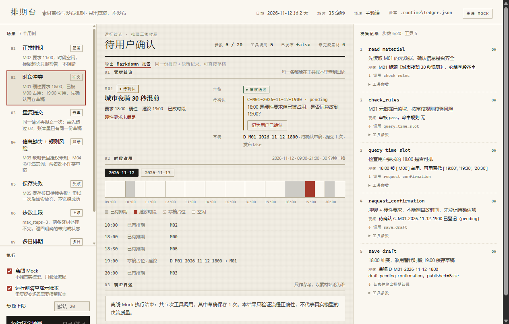

# 素材审核与发布排期 Agent（小影校招笔试题 · 项目题 1）

一个**模型驱动**的排期助手：读素材 → 按规则审核 → 查时段 → 处理冲突 → 保存**草稿**（绝不发布）。
模型每一步都要基于上一步的工具结果决定下一步动作（ReAct 循环），而不是走固定分支。

- 语言/框架：Python 3.10+ / LangGraph（显式 StateGraph + 工具节点）
- 模型：DeepSeek 官方 API（OpenAI 兼容），默认 `deepseek-v4-pro`；无密钥时可用离线 Mock 跑通全流程
- 交互形态：CLI（JSON 输入 → JSON 结果 + 逐步 trace，可选导出 Markdown 报告）；另附一个可选的 Web 演示界面（同一引擎的薄壳）

## 60 秒上手

```bash
# 1. 建环境（任选其一）
uv venv .venv && uv pip install --python .venv/Scripts/python.exe -r requirements.txt
# 或：python -m venv .venv && .venv/Scripts/python -m pip install -r requirements.txt

# 2. 离线跑一遍（不需要任何密钥，验证流程与守卫）
.venv/Scripts/python.exe -m src.main --input examples/02-conflict.input.json --offline \
  --out examples/02-conflict.output.json --trace examples/02-conflict.trace.json \
  --report-md examples/02-conflict.report.md

# 3. 一次跑完全部 7 个用例（会重置草稿账本）
.venv/Scripts/python.exe scripts/run_examples.py

# 4. 跑测试
.venv/Scripts/python.exe -m unittest discover -s tests -t . -v
```

macOS / Linux 把 `.venv/Scripts/python.exe` 换成 `.venv/bin/python` 即可。

## 接真实模型

```bash
cp .env.example .env         # 填入 DEEPSEEK_API_KEY=sk-...
.venv/Scripts/python.exe -m src.main --input examples/02-conflict.input.json \
  --out examples/02-conflict.live.output.json --trace examples/02-conflict.live.trace.json
```

不加 `--offline` 时走真实模型；缺少密钥会直接报错并提示改用 `--offline`，不会静默降级成假结果。

硬性时间被占用时，Agent 只能登记待确认项；确认由人来给（模型没有审批工具）：

```bash
# 02 跑完会打印/写出 C-M01-2026-11-12-1900；人点头后重跑，草稿才变成 draft_ready
.venv/Scripts/python.exe -m src.main --input examples/02-conflict.input.json --offline \
  --approve C-M01-2026-11-12-1900
```

模型 id 不是猜的：`LLM_MODEL` 的值取自 `curl https://api.deepseek.com/models`（Bearer 密钥）实测返回的
`deepseek-v4-pro` 与 `deepseek-flash`。想换模型改这一行即可，写错名字会在第一次请求时直接报错，不会悄悄换模型。

## 可选：Web 演示界面

CLI 是主入口，Web 只是一层薄壳：它调用的仍是 `src/main.py` 的 `run_pipeline()`，报告与 trace 与 CLI 完全同构。

```bash
.venv/Scripts/python.exe -m src.server        # 打开 http://127.0.0.1:7860
```

左侧七个场景就是 `examples/` 里的输入，点「运行这个场景」会跑一次并把报告、时段带、决策记录渲染出来；
「离线 Mock」勾选状态与 CLI 的 `--offline` 对应，取消勾选才走真实模型。演示账本写到 `.runtime/ledger.json`，
不污染 `data/drafts.json`。

界面走的是 SSE（`GET /api/stream`）：`TraceRecorder` 每录一步就把快照推给浏览器，所以真实模型那种十几秒的运行
能看到决策一条条长出来，而不是转圈结束才一次性刷出结果。上一轮结论在新一轮跑完前压暗显示，避免被误读成当前结果。

排期支持多日：`data/schedule.json` 的 `days` 里配置每一天的已有排期，请求可以用 `requested_date` 指定日期（不写就用默认日期）。
时段带上方会按天出现切换按钮，跑完自动跳到结果所在的日期。



报告还能导出：界面上的「导出 Markdown 报告」按钮（`GET /api/report.md`，服务端只保留最近一次运行，不落盘），
CLI 对应 `--report-md`。两者都复用 `src/markdown.py` 的同一份渲染，内容就是那份 `report` + 决策记录。

截图：`docs/images/web-02-conflict.png`（冲突→待确认）、`web-03-rules.png`（信息缺失 + 规则风险）、
`web-04-save-failure.png`（保存失败如实返回）、`web-06-step-limit.png`（步数上限中断）、
`web-02-conflict-live.png`（同一场景走真实 DeepSeek：右上角切到「真实模型」，决策依据由模型自己写）、
`web-02-conflict-streaming.png`（真实模型运行中的一帧：右栏逐条推送，中间上一轮结论压暗）、
`web-07-multiday.png`（多日排期：11-13 的占用与两份草稿、按天切换）、
`web-report-md.png`（结论下方多出「导出 Markdown 报告」）、`web-narrow.png`（884px 窄屏：单列堆叠，顶栏显示本轮耗时）。
键盘操作：`↑`/`↓`（或 `←`/`→`）在场景间移动、`Ctrl/⌘ + Enter` 运行，焦点有可见描边。

## 评审入口（按题面验收点）

| 验收点 | 用例 | 看什么 |
| --- | --- | --- |
| 正常排期 | `examples/01-normal.*` | `outcome=scheduled`，草稿 `draft_ready` |
| 时段冲突（参考实例：18:00 占用 → 19:00） | `examples/02-conflict.*` | `suggested_time=19:00`、`requires_user_confirmation=true`、`published=false` |
| 重复提交 | `examples/05-dedup.*`（紧接 02 运行） | 只有 1 份草稿，`submit_count=2`，`draft_id` 不变 |
| 素材信息缺失 | `examples/03-rules-and-missing.*` | M03 `needs_info`，`missing_fields` 非空，无草稿 |
| 规则风险 | 同上 | M04 `blocked`，`risk_reasons` 命中 R03 |
| 保存失败 | `examples/04-save-failure.*` | `result_status=save_failed`，无草稿，不谎报成功 |
| 步数上限 | `examples/06-step-limit.*` | `status=step_limit_reached`、`completed=false`、列出未完成素材 |
| 多日排期 | `examples/07-multiday.*` | M06 在 11-13 09:00 被 M02 占 → `scheduled_date=2026-11-13`、`suggested_time=09:30`、待确认；M07 同一天 20:00 直接落草稿；`published=false` |

每个 `.output.json` 是实际输出，`.trace.json` 是同一次运行的分步记录（动作 / 参数 / 观察摘要 / 下一步与决策依据）。

## 目录

```
src/        store / policy / tools / models / graph / trace / report / markdown / main / server（Web 演示用，标准库 http.server）
data/       合成素材、审核规则、已有排期、草稿账本
examples/   7 个用例的输入 + 实际输出 + trace + Markdown 报告（*.report.md）+ test-results.txt
web/        index.html / app.css / app.js（可选演示界面，无构建步骤）
tests/      58 个 unittest（规则、工具守卫、图级链路、trace 结构、多日排期、替代时段排序、Markdown 报告、HTTP 接口 / SSE 推送）
scripts/    run_examples.py（一键重跑全部用例）
docs/       01-需求 / 02-方案 / 03-评估 / 04-AI 使用 / 05-复盘 + images/（界面截图）
```

## 边界

- **只保存草稿**：工具集里没有发布工具，报告里 `published` 恒为 `false`（结构上不可能越权发布）。
- 草稿账本默认 `data/drafts.json`，可用 `--ledger` 指向别处；重跑前可用 `scripts/run_examples.py` 自动重置。
- 数据全部为合成数据，无真实用户/素材信息，无真实密钥入库。
- 多日排期只覆盖 `schedule.json` 里配置过的日期；频道的维度仍只有一个（`channel=main`）。
